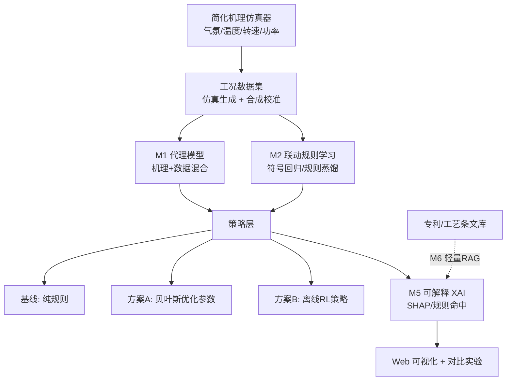
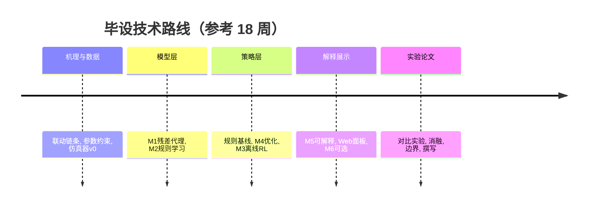

# 毕业设计开题报告

**课题名称**：回转窑—矿热炉关键参数联动调控的仿真与可视化原型（AI 增强）
**课题来源**：专利转化 / 学科竞赛（挑战杯）培育选题
**课题类型**：机理仿真 + AI 方法 + Web 可视化（数理 / 控制类）
**适用对象**：数理与控制基础较好、能独立开展仿真实验的本科毕业生
**文档版本**：v1.0　整理日期：2026-11-05

---

## 一、选题依据与意义

### 1.1 课题背景

回转窑—矿热炉是镍铁 **RKEF（Rotary Kiln–Electric Furnace）** 等火法冶金流程的核心两段：回转窑承担干燥、焙烧与预还原，矿热炉承担熔炼还原。两段并非独立运行，而是通过**出料温度与预还原度（金属化率）**强耦合——窑侧的气氛、温度、转速、给料量决定出料状态，进而决定矿热炉的还原电耗与功率设定。生产现场长期依赖操作经验进行两段参数的协同调节，缺乏可复现、可解释、可对比的联动分析工具。

与此同时，直接在实际窑炉上做参数试验成本高、风险大，且涉及工业安全认证，不适合作为教学与预研阶段的验证手段。因此，构建**离线仿真 + 可视化**的联动调控原型，具有明确的现实需求。

### 1.2 研究意义

- **工艺意义**：把「气氛 / 温度 / 转速 → 预还原度 → 功率 / 单位电耗」的联动链条显式化、可计算化，为两段协同调节提供可复现的分析依据。
- **方法意义**：以「机理仿真作数据发生器 + 数据驱动模型作增强」的混合范式，探索小样本、可外推、可解释的工业过程建模路径；并将联动规则从**人工编写**升级为**从数据中学出、再回写为可读规则**。
- **教学意义**：课题覆盖机理建模、参数化仿真、机器学习、优化、可解释性与 Web 可视化，综合训练强度适合数理 / 控制基础较好的学生。

### 1.3 立题支撑

本课题依托已有的**专利与技术交底材料**（涉及回转窑 / 矿热炉关键参数调节与联动控制），并以学科竞赛（挑战杯）培育项目为牵引。专利材料提供了真实的参数范围与工艺约束，使仿真模型不脱离工程语境；竞赛属性则要求成果具备可演示性与可对比性。

---

## 二、国内外研究现状

### 2.1 回转窑—矿热炉流程建模与仿真

针对回转窑，研究多集中于物料停留时间、传热与预还原动力学模型；针对矿热炉，则集中于电热耦合、料层电阻与单位电耗模型。由于两段机理复杂、参数众多，**面向教学与快速验证的简化机理模型**仍有需求，且需明确其误差来源与适用范围。

### 2.2 关键参数联动与过程调控

已有工作多分别讨论窑侧或炉侧的单体优化，对**两段之间以出料状态为中间量的联动调控**关注不足。工程上通常以操作规程（IF–THEN 经验规则）表达联动关系，规则依赖专家经验、难以量化评估，也难以回答「规则是否最优」。

### 2.3 机理 + 数据混合建模（代理模型）

纯机理模型计算昂贵、纯数据模型外推能力差。近年「**机理输出作先验、模型学习残差**」的残差建模，以及高斯过程、树模型、浅层神经网络等轻量代理模型，被视为兼顾数据效率与泛化的实用路径，在过程工业仿真中应用渐广。

### 2.4 规则学习与可解释 AI

符号回归、决策树蒸馏与规则提取可将黑箱模型转化为可读的 IF–THEN 规则；SHAP 等归因方法可解释单条预测的关键贡献因子。工业场景对可追溯性要求高，「**学得出、也说得清**」正成为该领域的主流偏好。

### 2.5 优化与强化学习在过程仿真中的应用

贝叶斯优化适用于小样本黑箱参数寻优；强化学习（DQN / PPO）在离线仿真 / 数字孪生环境中可用于学习调节策略。但二者在真实工业控制中的落地受安全与认证约束，目前多以**离线对比研究**形式出现，强调声明「仿真结论、非现场验证」。

### 2.6 现有不足与本课题切入点

现有研究或偏重单体设备机理、或偏重单一算法，缺少一个**面向两段联动、以「规则表达 + 对比实验设计」为创新主线、且明确划清工业红线的轻量可演示原型**。本课题以此为切入点，用 AI 增强规则学习与对比实验，而非堆砌模型。

---

## 三、研究目标与内容

### 3.1 研究目标

1. 构建**参数化简化机理仿真器**，对气氛、温度、转速与功率调节做规则或简化机理仿真，输出出料温度、预还原度、单位电耗等状态量；
2. 引入 AI 方法增强联动调控：**代理模型加速、联动规则学习、参数寻优、可解释性**，并可选离线强化学习策略与轻量 RAG 依据展示；
3. 实现 **Web 参数界面与联动效果可视化**；
4. 设计**对比实验**量化各 AI 模块贡献，形成实验记录与**边界说明**。

### 3.2 研究内容

- **数据层**：机理仿真器生成工况数据（合成 + 建议以一份公开 / 实测工况曲线校准），定义参数范围与工艺约束。
- **模型层**：M1 残差式代理模型；M2 联动规则学习并回写 IF–THEN 表。
- **策略层**：规则基线；M4 贝叶斯优化参数；M3 离线 RL 策略（选做）；M5 可解释性；M6 轻量 RAG（选做）。
- **展示层**：仿真器、参数界面、联动可视化、对比实验记录。

### 3.3 联动的物理链条（建模基础）

| 回转窑侧参数 | 中间状态量 | 矿热炉侧响应 |
| --- | --- | --- |
| 窑转速 ↑（停留时间 ↓） | 出料温度 ↓、预还原度 ↓ | 还原电耗 ↑，需提功率 |
| 窑温 ↑ | 出料温度 ↑、预还原度 ↑ | 电耗 ↓，可降功率 |
| 还原气氛 ↑（CO/CO₂ 比、配煤） | 预还原度 ↑、残碳 ↑ | 电耗 ↓，需防过还原 / 结圈 |
| 给料量 ↑ | 料层热负荷 ↑ | 功率设定需跟随 |

---

## 四、研究方法与技术路线

### 4.1 总体架构

**四层**：数据层（机理仿真作数据发生器）→ 模型层（代理模型 + 规则学习）→ 策略层（规则 / 优化 / RL 对比）→ 解释与展示层（XAI + RAG + 面板）。

### 4.2 关键方法

| 模块 | 方法 | 输入 → 输出 | 难度 |
| --- | --- | --- | --- |
| **M1 代理模型** | 高斯过程 / XGBoost / 浅层 MLP，**机理输出作先验、只学残差** | 参数组合 → 出料温度 / 预还原度 / kWh/t | ★★ 必做 |
| **M2 规则学习** ⭐ | 符号回归（PySR）拟合显式公式；或规则蒸馏提取 `IF 气氛>θ1 AND 转速<θ2 → 功率下调 ΔP`，**回写为可读 IF–THEN 表与人工规则并列** | 工况数据 → 可读联动规则表 | ★★★ 最贴题 |
| **M3 离线 RL** | 仿真器包成 Gym 环境；状态含出料状态与当前功率，动作为功率增减档位，奖励 `-(abs(ΔT) + λ·电耗 + μ·超调)`（ΔT 为温度偏差）；DQN / PPO | 状态 → 功率动作 | ★★★★ 选做 |
| **M4 参数寻优** | 贝叶斯优化（Optuna）对比网格 / 随机搜索；可多目标出 Pareto 前沿 | 参数空间 → 最低电耗组合 | ★★ 性价比高 |
| **M5 可解释性** | SHAP 归因、规则命中率、依据覆盖率；RL 用动作价值热图 | 建议 → 触发规则 + 贡献因子 | ★★ 必做 |
| **M6 轻量 RAG** | 专利 / 工艺条文向量检索作依据；LLM 仅生成解释与候选规则，**须人工审核、不进控制回路** | 条文库 → 依据引用 | ★★★ 可选 |

### 4.3 技术路线图

### 4.4 建议技术栈

Python（numpy / pandas / scipy）｜scikit-learn / XGBoost｜Optuna｜PySR 或 gplearn｜Stable-Baselines3（选做）｜SHAP｜Streamlit 或 Gradio / Vue｜Chroma + 本地条文语料（选做）。

---

## 五、创新点

1. **联动规则的可学习表达**（核心）：把原本依赖人工经验的 IF–THEN 规则，升级为「从仿真数据中学出、再回写为可读规则」，并将学习规则与人工规则并列对比，直接强化原课题「联动规则表达」的创新点。
2. **机理 + 数据混合的残差代理模型**：小样本下兼顾计算加速与外推稳定性，并量化加速比。
3. **多路线对比实验 + 消融设计**：从「规则 vs 无规则」升级为「机理 / 代理 / 参数优化 / 离线 RL」多路线对比，逐模块消融量化 AI 贡献。
4. **可解释与依据链**：每条建议附触发规则、关键贡献因子与（可选）专利条文依据，且明确 LLM / RL **不进入控制回路**。

---

## 六、进度安排

| 阶段 | 周次（参考） | 主要任务 | 里程碑 |
| --- | --- | --- | --- |
| 一、机理与数据 | 1–3 | 确定联动链条、参数范围与约束；机理仿真器 v0；生成工况数据 | 仿真器 v0 + 数据集 |
| 二、模型层 | 4–7 | M1 残差代理模型；M2 规则学习并回写 IF–THEN 表 | 模型 + 规则表 |
| 三、策略层 | 8–11 | 规则基线；M4 参数优化；M3 Gym 环境 + RL（按能力选做） | 策略对比雏形 |
| 四、解释与展示 | 12–14 | M5 XAI；Web 参数界面与联动可视化；M6 RAG（可选） | 完整原型 |
| 五、实验与论文 | 15–18 | 对比实验 + 消融；边界说明；撰写 | 实验报告 + 论文 |

**难度分档**：基础版（机理仿真 + M1 + M4 + M5 + 对比实验，★★）｜进阶版（基础 + M2，★★★，推荐主力）｜拔高版（进阶 + M3，★★★★）。按学生数理 / 控制基础，建议以进阶版为主、M3 作为选做加分项。

---

## 七、预期成果

- 可运行的**参数化仿真器**（机理 + 代理模型）与 **Web 参数界面 / 联动可视化**；
- **联动规则表**（人工规则 vs 学习规则并列）；
- **对比实验记录**（含消融实验、指标表、边界说明）；
- 毕业设计论文 1 篇；
- （选做）Gym 环境与 RL 训练脚本、RAG 依据模块。

---

## 八、研究的局限与风险（红线）

- ❌ **不做真实窑炉控制、不做工业安全认证**，仅离线仿真；
- ❌ **不声称工业控制效果**，成果为「原型 / 仿真结论」，非现场验证；
- 机理为**简化建模**，须声明误差来源与适用范围；数据含合成成分，建议至少以一份公开 / 实测工况曲线校准；
- **RL / LLM 仅在仿真内运行**，输出为「建议」而非可执行控制指令；LLM 生成的候选规则须人工审核；
- 仿真参数**不得外推至超出工艺合理区间**，避免得出误导性结论。

---

## 九、参考文献

> 以下为**建议检索方向与代表性文献类型**，请按学校格式替换为实际检索到的文献（严禁编造引文）：

1. RKEF / 回转窑预还原 / 矿热炉熔炼机理：检索「RKEF rotary kiln electric furnace」「回转窑 预还原 金属化率」「矿热炉 单位电耗 模型」。
2. 回转窑传热与停留时间模型：检索「rotary kiln heat transfer residence time model」。
3. 代理模型与残差建模：检索「surrogate model residual modeling process industry」「hybrid physics-informed surrogate」。
4. 符号回归与规则提取：检索「symbolic regression」「rule extraction decision tree distillation」。
5. 贝叶斯优化与多目标参数寻优：检索「Bayesian optimization process parameters」「multi-objective NSGA-II」。
6. 强化学习在过程控制仿真中的应用：检索「reinforcement learning process control simulation」「offline RL digital twin」。
7. 可解释 AI：检索「SHAP explainable AI industrial」「可解释 工业 模型」。
8. 专利与技术规程：本课题依托的自有专利 / 技术交底、操作规程文本。

（建议数据库：中国知网 CNKI、万方、IEEE Xplore、ScienceDirect；开题报告中需列出不少于 15 篇近五年中英文文献，并补入所依托专利的著录信息。）

---

## 十、附录：对比实验设计（核心）

### 10.1 实验组（统一输入条件，保证可比）

| 组 | 配置 | 目的 |
| --- | --- | --- |
| Baseline | 纯规则 + 机理仿真 | 参照 |
| A | 规则 + M1 代理模型加速 | 验证「快而准」 |
| B | 规则 + M4 贝叶斯优化参数 | 验证「更省电」 |
| C | M3 离线 RL 策略（选做） | 验证「学得更好」 |
| D | C + M6 RAG 依据（可选） | 验证「说得清」 |

**消融实验**：逐个移除 M1 / M2 / M5，量化各模块贡献。

### 10.2 指标定义

| 指标 | 口径 |
| --- | --- |
| 出料温度跟踪误差 | `mean(abs(T_out − T_set))` |
| 预还原度达标率 | 预还原度落在目标区间的时段占比 |
| 单位电耗 | kWh/t（越低越好） |
| 功率超调 / 波动 | 功率设定变化率、超调幅度 |
| 工况越界次数 | 温度 / 气氛 / 功率越界计数 |
| 联动响应步数 | 上游扰动到下游功率响应的仿真步数 |
| 推理耗时 | 单步决策耗时（机理 vs 代理模型加速比） |
| 可解释覆盖率 | 建议附「规则 / 依据」的比例 |
| 样本效率 | 贝叶斯优化达到目标所需评估次数 |

> 指标覆盖四条价值：**更省电、更稳、更快、更说得清**。

---

*本开题报告由课题方法思路扩写而成；具体参数范围、机理公式与约束阈值需结合真实工艺资料与学校要求进一步细化。*
