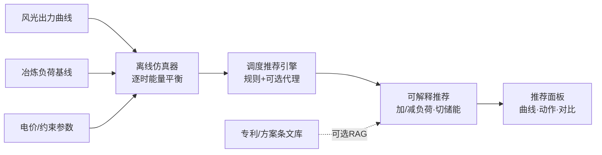
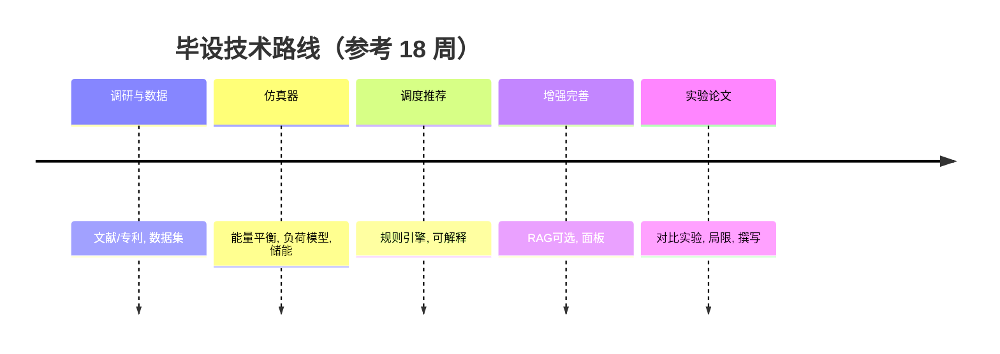

# 毕业设计开题报告

**课题名称**：虚拟电厂—柔性冶炼负荷的绿电调度仿真与智能推荐原型
**课题类型**：软件系统 + 算法仿真（计算机 / 能源信息交叉）
**文档版本**：v1.0　整理日期：2026-11-05

---

## 一、选题依据与意义

### 1.1 课题背景

在「碳达峰、碳中和」目标驱动下，我国新能源（风、光）装机规模高速增长，但新能源出力的波动性与间歇性导致**弃风弃光**与电网调节压力持续存在。与此同时，冶金冶炼（矿热炉、电弧炉等）属于典型的高耗能、连续生产型负荷，其用电特性中存在一定的**可平移、可调节空间**（柔性负荷）。将这类柔性冶炼负荷聚合进**虚拟电厂（Virtual Power Plant, VPP）**与**源网荷储**体系，利用新能源出力充裕（绿电余量）的时段安排高耗能生产、在出力不足时段降负荷或切储能，是提升新能源就地消纳、降低用电成本、平抑电网峰谷的重要技术路径。

### 1.2 研究意义

- **应用意义**：为高耗能行业参与电网柔性互动提供可运行的原型工具，验证「绿电余量驱动柔性冶炼」的可行性与收益空间，契合工业绿色低碳转型需求。
- **方法意义**：在调度推荐中强调**可解释性**（规则/显式目标驱动，而非黑箱），使每一条「加/减负荷、切储能」建议都能回溯依据，降低工业场景对 AI 决策的信任门槛。
- **教学意义**：课题覆盖数据处理、仿真建模、规则引擎、可视化与可选的检索增强生成（RAG），适合作为计算机类学生综合训练。

### 1.3 立题支撑

本课题并非凭空设定，而是基于已有的专利 / 技术交底材料：
- **「消纳新能源余量的柔性冶炼生产管理」**：将新能源出力预测与冶炼工序排产耦合，按绿电余量动态调节生产节奏；
- **「虚拟电厂与 AI 柔性冶炼绿电供应控制」**：以 VPP 为聚合层，用 AI 给出冶炼负荷加/减负荷与储能切换的控制建议；
- 并参考绿电资料中**源网荷储、微电网 / VPP** 相关方向（如光储直柔园区微网、充放电策略优化、防逆流调度等）。

上述材料为课题提供了真实的技术边界与工程语境，使研究具有落地指向。

---

## 二、国内外研究现状

### 2.1 虚拟电厂与源网荷储

虚拟电厂通过聚合分布式资源（分布式发电、储能、可控负荷）参与电网调度与市场，已成为新型电力系统的重要形态。研究多聚焦于 VPP 的聚合建模、优化调度与市场博弈。近年来，**「源网荷储一体化」**与园区级微电网（含光储直柔架构）成为工程落地热点，强调本地新能源的就地消纳与对主网支撑能力的协同。

### 2.2 柔性负荷参与需求响应

高耗能工业负荷（如电解、冶炼）因用电量大、调节潜力可观，被视作需求响应的重要资源。相关研究表明，在合理约束下对冶炼类负荷进行**时段平移**与**功率调节**，可在不明显影响产品质量的前提下提供可观的灵活性。但难点在于：不同炉型的启停特性、热惯性、最小负荷与产品质量约束差异大，需要**参数化、可解释的负荷模型**而非简单近似。

### 2.3 新能源消纳与储能调度

储能（电化学、压缩空气等）被视为平抑新能源波动的核心手段。研究普遍关注多时间尺度下的充放电优化、复合储能配比与经济运行。近期公开专利中已出现以压缩气体储能为核心、冷热与电池梯级缓冲的风光电力配置系统，以及基于深度强化学习的场站充放电策略自动优化等思路，说明「算法优化 + 工程约束」是主流趋势。

### 2.4 可解释 AI 在能源调度中的应用

能源调度对安全性、可追溯性要求高，黑箱模型难以被运营方采信。因此，将优化目标（消纳率、成本、峰谷差）显式表达、以规则或透明代理模型生成决策，并输出可读依据，正成为该领域的偏好做法。检索增强生成（RAG）进一步可将专利、规范条文作为决策依据展示，提升说服力。

### 2.5 现有不足与本课题切入点

现有工作多偏向电网侧宏观调度或单一算法优化，**面向「柔性冶炼负荷 + 绿电余量」的轻量、可解释、可演示原型**仍较缺乏；且多数系统依赖真实数据接入，难以在教学 / 预研阶段快速验证。本课题以**离线仿真 + 可解释推荐**切入，规避真实系统接入风险，聚焦方法原型与对比验证。

---

## 三、研究目标与内容

### 3.1 研究目标

1. 构建一套**离线仿真器**，加载 / 合成风光出力与柔性冶炼负荷曲线，模拟「源—荷—储」逐时能量平衡；
2. 设计**调度推荐引擎**：以规则为主、可选简单代理模型为辅，输出「加 / 减负荷、储能充放」的**可解释**建议；
3. 实现**推荐面板**：可视化曲线、调度动作与对比结果；可选接入**轻量 RAG** 调阅专利 / 方案条文作为依据展示；
4. 通过**对比实验**量化柔性调度相对固定负荷的消纳率与成本改善，并给出**局限说明**。

### 3.2 主要研究内容

- **数据层**：获取 / 合成风光出力曲线（建议至少用一份真实公开曲线校准），构建参数化冶炼负荷基线。
- **仿真层**：逐时能量平衡、储能（电化学 / 充放）模型、弃电与购电核算。
- **推荐层**：调度规则引擎（目标显式加权）+ 可解释输出；可选简单代理（贪心 / 线性规划 / 轻量强化学习）。
- **展示层**：仿真器 + 推荐面板 + 对比实验；可选 RAG 依据模块。

---

## 四、研究方法与技术路线

### 4.1 总体技术架构

### 4.2 关键方法

- **仿真建模**：以小时（或亚小时）为步长，按能量守恒核算各时段发电、负荷、储能与电网交换；储能采用 SOC 演化 + 效率 + 功率约束模型。
- **柔性负荷模型**：锁定一种炉型，依据公开典型负荷曲线与调节约束（最小负荷、爬坡率、热惯性）建立**可调带**模型，避免「任意加减负荷」的不真实。
- **调度规则引擎**：将「最大化绿电消纳 / 最小化网电成本 / 平抑峰谷」等目标显式加权，生成逐时动作；可选以线性规划（PuLP / OR-Tools）作为对比代理。
- **可解释输出**：每条建议附触发规则 / 目标贡献与（可选）RAG 检索到的专利条文引用。
- **RAG（可选）**：将专利 / 交底条文电子化建库，向量检索后作为依据展示。

### 4.3 技术路线图

---

## 五、创新点

1. **可解释的绿电调度推荐**：以显式目标与规则替代黑箱，每条建议可回溯依据，契合工业可信决策需求。
2. **柔性冶炼负荷的简化但合理建模**：参数化炉型约束，兼顾仿真可行性与工艺真实性。
3. **专利条文 RAG 依据展示（可选）**：将自有专利 / 交底材料接入推荐解释，形成「技术依据链」。

---

## 六、进度安排

| 阶段 | 周次（参考） | 主要任务 | 里程碑 |
| --- | --- | --- | --- |
| 一、调研与数据 | 1–3 | 文献 / 专利精读；确定炉型与约束；获取 / 合成曲线 | 数据集 v0 + 调研报告 |
| 二、仿真器与负荷模型 | 4–7 | 能量平衡仿真；柔性负荷参数化；储能模型 | 可运行的仿真器 |
| 三、调度与推荐 | 8–11 | 规则引擎；可解释输出；基线对比 | 推荐引擎 + 面板雏形 |
| 四、增强与完善 | 12–14 | 可选 RAG 依据；面板美化；边界处理 | 完整原型 |
| 五、实验与论文 | 15–18 | 对比实验；指标统计；局限说明；撰写 | 实验报告 + 论文 |

---

## 七、预期成果

- 可运行的**离线仿真器**与**推荐面板**（可演示）；
- **对比实验报告**：量化绿电消纳率提升、网电购电成本下降等指标；
- **局限与边界说明**文档；
- 毕业设计论文 1 篇；
- （可选）专利 / 方案条文 RAG 依据模块。

---

## 八、研究的局限与风险（红线）

- ❌ **不接入真实电网 / DCS / 工业控制系统**，仅离线仿真；
- ❌ **不声称工业控制效果**，成果为「原型 / 仿真结论」，非现场验证；
- 仿真**非实时**、数据含**合成成分**（需用真实公开曲线校准）；
- 柔性负荷约束为**简化建模**，与真实 DCS 控制存在差距；
- RAG 依赖专利 / 交底条文的**电子化语料质量**。

---

## 九、参考文献

> 以下为**建议检索方向与代表性文献类型**，请按学校格式替换为实际检索到的文献（严禁编造引文）：

1. 虚拟电厂聚合建模与优化调度：检索关键词「virtual power plant aggregation optimization」「虚拟电厂 优化调度 综述」。
2. 需求响应与高耗能工业柔性负荷：检索「demand response industrial load」「高耗能 负荷 柔性 需求响应」。
3. 新能源消纳与储能调度：检索「renewable accommodation storage dispatch」「新能源 消纳 储能 优化」。
4. 冶炼 / 电弧炉负荷特性与调节潜力：检索「arc furnace load flexibility」「矿热炉 负荷 调节」。
5. 可解释 AI 与能源调度：检索「explainable AI energy dispatch」「可解释 调度 推荐」。
6. 源网荷储 / 光储直柔园区微网：检索「source-grid-load-storage」「光储直柔 微电网」。
7. 政策与产业报告：国家发展改革委、国家能源局关于新型电力系统与需求侧响应的公开文件。

（建议数据库：中国知网 CNKI、IEEE Xplore、ScienceDirect；开题报告中需列出不少于 15 篇近五年中英文文献。）

---

## 十、附录：对比实验核心指标（摘要）

| 指标 | 口径 |
| --- | --- |
| 绿电消纳率 | 绿电被负荷+储能就地消纳量 ÷ 绿电总出力 |
| 弃风弃光率 | 未消纳绿电 ÷ 绿电总出力 |
| 网电购电成本 | Σ(网电购电量 × 分时电价) |
| 峰段网电占比 | 峰段网电用量 ÷ 总网电用量 |
| 负荷调节次数 / 幅度 | 加/减负荷动作计数与平均幅度 |
| 储能循环次数 / SOE 轨迹 | 充放计数、荷电状态曲线 |
| 推荐可解释性 | 规则命中率、依据覆盖率（RAG 时） |

实验设置：基线（固定负荷）vs 规则柔性 vs 规则+代理 vs（可选）RAG；统一输入以保证可比性。

---

*本开题报告由课题框架扩写而成，具体周次、指标阈值、炉型参数需结合学校要求与真实数据进一步细化。*
