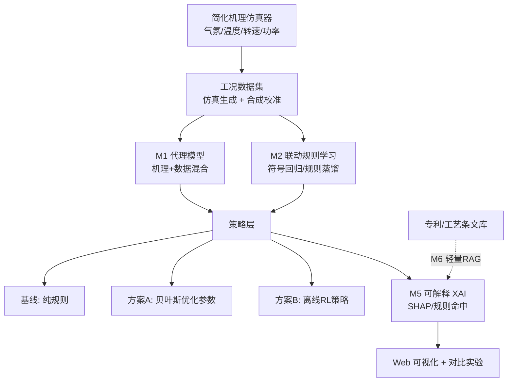

# AI 增强方法思路：回转窑—矿热炉关键参数联动调控的仿真与可视化原型

> 面向毕业设计（数理 / 控制基础较好、能独立做仿真实验）
> 在原「规则 / 简化机理仿真 + Web 可视化」基础上，给出**更多与 AI 结合**的方法设计
> 版本 v1.0　整理日期：2026-11-05

---

## 一、题目再定位：联动的物理链条

回转窑（干燥 / 焙烧 / 预还原）与矿热炉（熔炼还原）是镍铁 **RKEF** 等工艺的连续两段，存在明确的耦合关系：

| 回转窑侧参数 | 中间状态量 | 矿热炉侧响应 |
| --- | --- | --- |
| 窑转速 ↑（停留时间 ↓） | 出料温度 ↓、预还原度（金属化率）↓ | 还原电耗 ↑，需提功率 |
| 窑温 ↑ | 出料温度 ↑、预还原度 ↑ | 电耗 ↓，可降功率 |
| 还原气氛 ↑（CO/CO₂ 比、配煤） | 预还原度 ↑、残碳 ↑ | 电耗 ↓，但需防过还原 / 结圈 |
| 给料量 ↑ | 料层热负荷 ↑ | 功率设定需跟随 |

**联动的本质**：以「出料温度 + 预还原度」为中间状态，把上游工况映射到下游的功率设定与单位电耗。原题目用规则或简化机理表达这条映射；AI 的价值在于**把这条映射学得更准、调得更优、说得更清楚**。

---

## 二、总体方法架构：AI 嵌在四层

**四层**：数据层（机理仿真当数据发生器）→ 模型层（代理模型 + 规则学习）→ 策略层（规则 / 优化 / RL 对比）→ 解释与展示层（XAI + RAG + 面板）。

---

## 三、六个 AI 结合模块（逐模块可落地）

### M1 机理 + 数据混合的代理模型（Surrogate）
- **做什么**：用简化机理仿真跑出「输入参数 → 出料温度/预还原度/电耗」数据，训练轻量代理模型替代耗时机理计算。
- **方法**：高斯过程（小样本、带不确定性）、XGBoost / 浅层 MLP（大样本）；机理输出作先验，模型只学残差（**残差建模**，数据效率高、外推更稳）。
- **输入/输出**：`(转速, 窑温, 气氛, 给料, 功率)` → `(出料温度, 预还原度, kWh/t)`。
- **评价**：RMSE / R²、推理耗时相对机理仿真的加速比、外推区间误差。
- **难度**：★★（基础，建议必做）

### M2 联动规则的「可学习表达」（本题创新点强化）
- **做什么**：原创新点在「联动规则表达」。AI 版把硬编码规则升级为**从数据中学出、再以可读规则输出**。
- **方法**：符号回归（如 gplearn / PySR）拟合显式公式；或先用 M1 代理模型生成数据，再用决策树 / 规则蒸馏提取 `IF 气氛>θ1 AND 转速<θ2 → 功率下调 ΔP` 这类规则。
- **关键**：学出的规则必须**回写成可阅读的 IF–THEN 表**，与人工工艺规则并列展示对比——这正是「联动规则表达」的创新落点。
- **评价**：规则条数 / 复杂度、与人工规则的一致率、在仿真上的控制效果。
- **难度**：★★★（建议做，最贴题）

### M3 离线强化学习控制策略（进阶）
- **做什么**：把仿真器包成 Gym 风格环境，用 RL 学「功率调节策略」，与规则基线对比。
- **方法**：状态 = 出料温度/预还原度/当前功率/工况标签；动作 = 功率增减档位；奖励 = `-(|温度偏差| + λ·单位电耗 + μ·功率超调)`。算法用 DQN（离散动作）或 PPO（连续）。
- **红线**：**仅在离线仿真中训练与评估**，输出为「建议」，不接真实窑炉 / DCS。
- **评价**：收敛曲线、相对规则基线的电耗改善、越界次数、策略可解释性（动作分布可视化）。
- **难度**：★★★★（拔高项，可按学生能力选做）

### M4 贝叶斯优化 / 参数寻优
- **做什么**：在 `(转速, 窑温, 气氛, 功率)` 参数空间里找「单位电耗最低 + 出料指标达标」的组合。
- **方法**：贝叶斯优化（Optuna / scikit-optimize）对比网格搜索 / 随机搜索；也可做多目标（NSGA-II）展示 Pareto 前沿。
- **评价**：达到目标所需评估次数（样本效率）、最优电耗、约束满足率。
- **难度**：★★（易做，性价比高）

### M5 可解释性（XAI）
- **做什么**：让每条调节建议能回答「为什么」。
- **方法**：SHAP 解释 M1 代理模型；规则命中率 / 依据覆盖率解释 M2；RL 用动作价值热图。
- **输出**：面板上每条建议附「触发规则 + 关键贡献因子 + 依据」。
- **难度**：★★（必做，呼应红线与工业可信）

### M6 轻量 RAG / LLM 解释层（可选）
- **做什么**：把专利、工艺规程、操作条文电子化建库，检索后作为联动建议的**依据展示**；或让 LLM 把自然语言工艺描述整理成候选规则（**须人工审核**）。
- **关键边界**：LLM **不直接发控制指令**，只做依据检索与解释生成；避免幻觉进入仿真回路。
- **评价**：依据检索命中率、依据覆盖率、人工审核一致率。
- **难度**：★★★（可选，语料质量是前提）

---

## 四、对比实验设计（AI 版）

### 4.1 实验组
| 组 | 配置 | 目的 |
| --- | --- | --- |
| Baseline | 纯规则 + 机理仿真 | 参照 |
| A | 规则 + M1 代理模型加速 | 验证「快而准」 |
| B | 规则 + M4 贝叶斯优化参数 | 验证「更省电」 |
| C | M3 离线 RL 策略 | 验证「学得更好」 |
| D（可选） | C + M6 RAG 依据 | 验证「说得清」 |

统一输入：同一组工况曲线 / 同一初始条件 / 同一约束，保证可比。**消融实验**：逐个去掉 M1/M2/M5，量化各模块贡献。

### 4.2 指标定义
| 指标 | 口径 |
| --- | --- |
| 出料温度跟踪误差 | `mean(|T_out − T_set|)` |
| 预还原度达标率 | 预还原度落在目标区间的时段占比 |
| 单位电耗 | kWh/t（越低越好） |
| 功率超调 / 波动 | 功率设定变化率、超调幅度 |
| 工况越界次数 | 温度 / 气氛 / 功率越界计数 |
| 联动响应步数 | 上游扰动到下游功率响应的仿真步数 |
| 推理耗时 | 单步决策耗时（机理 vs 代理模型加速比） |
| 可解释覆盖率 | 建议附「规则/依据」的比例（XAI / RAG） |
| 样本效率 | 贝叶斯优化达到目标所需评估次数 |

> 这套指标把「**更省电、更稳、更快、更说得清**」四条价值都量化了，答辩时是硬货。

---

## 五、技术路线（参考 18 周）

| 阶段 | 周次 | 任务 |
| --- | --- | --- |
| 一、机理与数据 | 1–3 | 确定联动链条、参数范围与约束；机理仿真器 v0；生成工况数据 |
| 二、模型层 | 4–7 | M1 代理模型（残差建模）；M2 规则学习并回写 IF–THEN 表 |
| 三、策略层 | 8–11 | 规则基线；M4 参数优化；M3 Gym 环境 + RL（按能力选做） |
| 四、解释与展示 | 12–14 | M5 XAI；Web 参数界面与联动可视化；M6 RAG（可选） |
| 五、实验与论文 | 15–18 | 对比实验 + 消融；边界说明；撰写 |

---

## 六、红线与边界（必须写进论文）

- ❌ **不做真实窑炉控制、不做工业安全认证**；仅离线仿真。
- ❌ **不声称工业控制效果**；成果为「原型 / 仿真结论」。
- 机理为**简化建模**，需声明误差来源与适用范围；数据含合成成分，建议至少用一份公开/实测工况曲线校准。
- **RL / LLM 仅在仿真内运行**，输出为「建议」，不构成可执行控制指令；LLM 生成规则须人工审核。
- 仿真参数不得外推至超出工艺合理区间（防止得出误导性结论）。

---

## 七、可执行度与难度分级

| 档位 | 组合 | 难度 | 适合 |
| --- | --- | --- | --- |
| 基础版（稳过） | 机理仿真 + M1 + M4 + M5 + 对比实验 | ★★ | 本科，工作量饱满 |
| 进阶版（良好） | 基础 + M2 规则学习（贴题创新） | ★★★ | 推荐主力方案 |
| 拔高版（优秀） | 进阶 + M3 离线 RL（+ 可选 M6） | ★★★★ | 数理/控制强、工期充裕 |

**结论**：AI 结合点不是堆模型，而是围绕原创新点「**联动规则表达 + 对比实验设计**」做增强——M2 让规则从「人写」变成「学出来再写给人看」，M1/M4/M3 让对比实验从「规则 vs 无规则」升级为「机理/代理/优化/RL 多路线 + 消融」，M5/M6 让每条建议可追溯。这样 AI 是为主线服务的，不是贴标签。

---

## 八、建议交付物

- 仿真器（机理 + 代理模型，可运行）
- 联动规则表（人工规则 vs 学习规则并列）
- Web 参数界面 + 联动可视化
- 对比实验报告（含消融、指标表、边界说明）
- 论文 1 篇
- （可选）Gym 环境与 RL 训练脚本、RAG 依据模块

---

*本方法思路为可迭代骨架；具体参数范围、机理公式、约束阈值需结合真实工艺资料与学校要求细化。*
