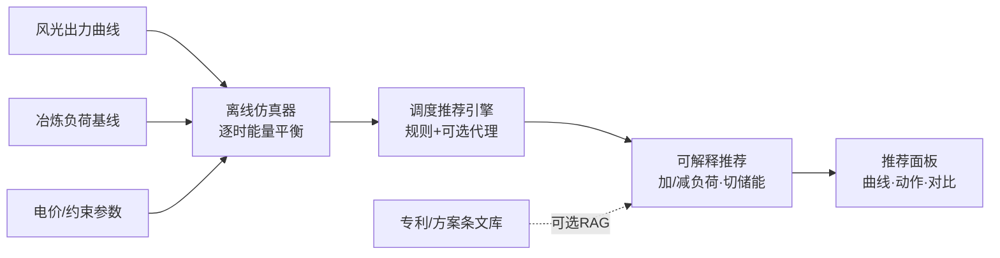
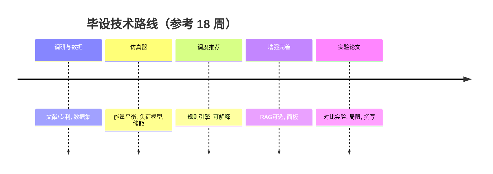

# 毕业设计开题框架：虚拟电厂—柔性冶炼负荷的绿电调度仿真与智能推荐原型

> 适用对象：计算机 / 软件工程 / 能源信息类本科毕业设计
> 文档性质：任务书骨架（可直接裁剪为开题报告、任务书）
> 版本：v1.0　整理日期：2026-11-05

---

## 一、选题背景与依据

### 1.1 现实背景
在「双碳」目标与新型电力系统建设下，**高比例新能源接入带来严重的弃风弃光与出力波动问题**；与此同时，冶炼（矿热炉、电弧炉等）是高耗能、可部分调节的柔性负荷。将柔性冶炼负荷纳入**虚拟电厂（VPP）/ 源网荷储**体系，用绿电余量驱动可平移的冶炼生产，是提升新能源就地消纳、降低用电成本的重要路径。

### 1.2 专利 / 交底依据（立题支撑）
本题目基于以下真实技术积累，避免「拍脑袋立题」：
- **「消纳新能源余量的柔性冶炼生产管理」**：将新能源出力预测与冶炼工序排产耦合，按绿电余量动态调节生产节奏。
- **「虚拟电厂与 AI 柔性冶炼绿电供应控制」**：以 VPP 为聚合层，用 AI 给出冶炼负荷的加/减负荷与储能切换控制建议。
- 参考绿电库资料中的**源网荷储、微电网 / VPP** 相关材料（如光储直柔园区微网、充放电策略优化、防逆流调度等方向）。

### 1.3 拟解决的核心问题
给定一天（或多日）的**风光出力曲线**与**冶炼负荷基线曲线**，如何离线、可解释地给出：
> 何时加/减冶炼负荷？何时切储能充/放？依据是什么？

---

## 二、研究目标

1. 构建一套**离线仿真器**，能加载/合成风光出力与柔性冶炼负荷曲线，模拟「源—荷—储」的逐时能量平衡。
2. 设计**调度推荐引擎**：以规则为主、可选简单代理模型为辅，输出「加/减负荷、储能充放」的可解释建议。
3. 实现**推荐面板**：可视化曲线、调度动作与对比结果；可选**轻量 RAG** 调阅专利/方案条文作为推荐依据展示。
4. 通过**对比实验**量化柔性调度相对固定负荷的消纳率与成本改善，并给出**局限说明**。

---

## 三、研究内容与边界（红线）

### 3.1 研究内容
- 数据层：风光出力曲线（公开数据集校准 + 合成扩展）、冶炼负荷基线曲线（按炉型参数化）。
- 仿真层：逐时能量平衡、储能（电化学/充放）模型、弃电/购电核算。
- 推荐层：调度规则引擎 + 可解释输出；可选简单代理（贪心 / 线性规划 / 轻量 RL）。
- 展示层：仿真器 + 推荐面板 + 对比实验。

### 3.2 红线（必须在论文中明确声明）
- ❌ **不接入真实电网 / DCS / 工业控制系统**；仅离线仿真。
- ❌ **不声称工业控制效果**；成果为「原型 / 仿真结论」，非现场验证。
- 所有调度建议均为**推荐**，不具强制执行含义。

---

## 四、技术路线与总体架构

### 4.1 总体架构（数据流）

### 4.2 模块分解
| 模块 | 职责 | 关键产出 |
| --- | --- | --- |
| 数据生成/加载 | 读公开数据或合成曲线；参数化炉型负荷 | 标准化时序数据集 |
| 柔性负荷模型 | 按炉型给出可调范围、启停/热惯性约束 | 负荷可调带（min/max/爬坡） |
| 储能模型 | SOC 演化、充放效率、功率约束 | 储能轨迹 |
| 调度规则引擎 | 目标（消纳率/成本/峰谷）显式加权，生成动作 | 逐时调度指令 |
| 推荐生成 | 将指令转自然语言 + 依据 | 可解释建议 |
| RAG 依据（可选） | 向量检索专利/方案条文 | 依据引用 |
| 可视化面板 | 曲线、动作、对比 | Web 面板 |

### 4.3 建议技术栈
- 语言/计算：Python（pandas、numpy）。
- 优化（可选）：PuLP / OR-Tools 做线性规划基线。
- 面板：Streamlit 或 Gradio（快速）；或 React/Vue（若重交互）。
- RAG（可选）：LangChain + 向量库（Chroma/FAISS）+ 本地专利条文语料。

---

## 五、技术路线图

| 阶段 | 周次（参考） | 主要任务 | 里程碑 |
| --- | --- | --- | --- |
| 一、调研与数据 | 1–3 | 文献/专利精读；确定炉型与约束；获取/合成曲线 | 数据集 v0 + 调研报告 |
| 二、仿真器与负荷模型 | 4–7 | 能量平衡仿真；柔性负荷参数化；储能模型 | 可跑通的仿真器 |
| 三、调度与推荐 | 8–11 | 规则引擎；可解释输出；基线对比 | 推荐引擎 + 面板雏形 |
| 四、增强与完善 | 12–14 | 可选 RAG 依据；面板美化；异常/边界处理 | 完整原型 |
| 五、实验与论文 | 15–18 | 对比实验；指标统计；局限说明；撰写 | 实验报告 + 论文 |

---

## 六、对比实验设计

### 6.1 实验设置
- **基线（Baseline）**：固定冶炼负荷 + 网电全额供给，无柔性调节、无储能调度。
- **方案 A（规则柔性）**：基于规则引擎的加/减负荷与储能切换。
- **方案 B（规则 + 简单代理）**：规则基础上引入贪心/线性规划优化目标。
- **方案 C（可选）**：方案 B + RAG 依据展示。

统一输入：同一组风光曲线 + 同一负荷基线 + 同一电价/约束，保证可比性。

### 6.2 指标定义（量化、可评审）

| 指标 | 定义 / 口径 | 说明 |
| --- | --- | --- |
| **绿电消纳率** | 绿电被负荷+储能就地消纳量 ÷ 绿电总出力 | 核心目标，越高越好 |
| **弃风弃光率** | 未被消纳的绿电 ÷ 绿电总出力 | 与消纳率互补 |
| **网电购电成本** | Σ(网电购电量 × 分时电价) | 元；越低越好 |
| **峰段网电占比** | 峰段网电用量 ÷ 总网电用量 | 反映避峰效果 |
| **峰谷差 / 最大需量** | 日内负荷峰谷差或最大需量 | 反映对电网友好度 |
| **负荷调节次数 / 幅度** | 加/减负荷动作次数、平均幅度 | 评估柔性「代价」 |
| **储能循环次数 / SOE 轨迹** | 充放次数、荷电状态曲线 | 评估储能行为合理性 |
| **推荐可解释性** | 规则命中率、依据覆盖率（RAG 时） | 方案差异化亮点 |
| **计算时延** | 单次调度决策耗时 | 离线可忽略，但建议记录 |

> 公式示例：
> `绿电消纳率 = (Σ min(绿电出力_t, 负荷_t + 储能可充_t)) / Σ 绿电出力_t`

### 6.3 预期结果（在论文中需以实测为准，此处仅示口径）
- 柔性调度相对基线：**绿电消纳率提升 X%**、**网电购电成本下降 Y%**、**峰段网电占比下降 Z%**。
- 给出「调节代价」（负荷调节次数/幅度）与收益的权衡曲线。

---

## 七、创新点（建议提炼）

1. **可解释的绿电调度推荐**：以显式目标与规则替代黑箱，每条建议可回溯依据。
2. **柔性冶炼负荷的简化但合理建模**：参数化炉型约束，兼顾仿真可行性与工艺真实性。
3. **专利条文 RAG 依据展示（可选）**：将自有专利/交底材料接入推荐解释，形成「技术依据链」。

---

## 八、局限与风险（须在论文中诚实声明）

- 仿真**非实时**、未经现场验证；结论限于原型层面。
- 数据含**合成成分**，需用至少一份真实公开曲线校准，避免「自圆其说」。
- 柔性负荷约束为**简化建模**，与真实 DCS 控制存在差距。
- RAG 依赖专利/交底条文的**电子化语料质量**。

---

## 九、交付物清单

- [ ] 仿真器源代码（可运行、有说明）
- [ ] 推荐面板（可演示）
- [ ] 对比实验报告（指标统计 + 图表）
- [ ] 局限与边界说明文档
- [ ] 毕业设计论文
- [ ] （可选）专利/方案条文 RAG 依据模块

---

*注：本文档为框架骨架，具体周次、指标阈值、炉型参数需结合学校要求与真实数据进一步细化。*
